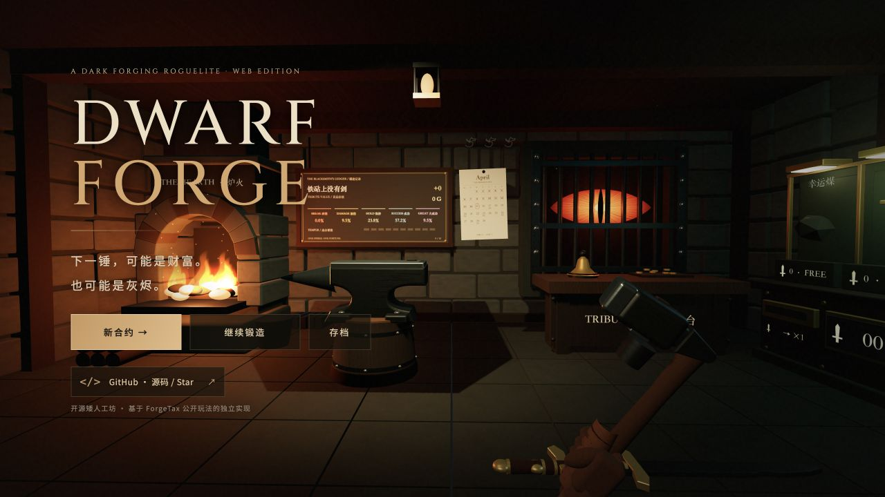
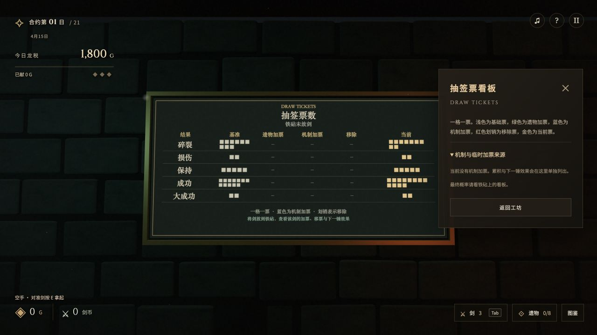
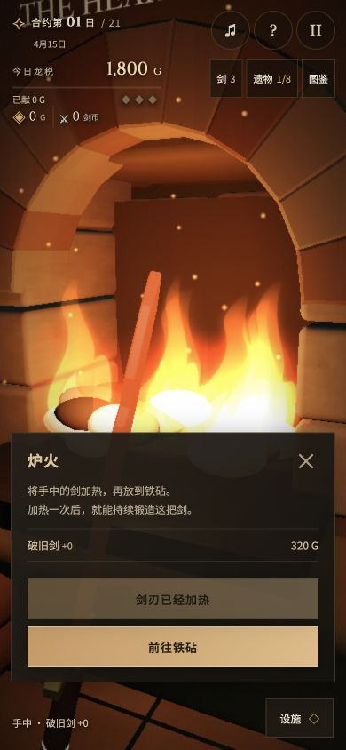
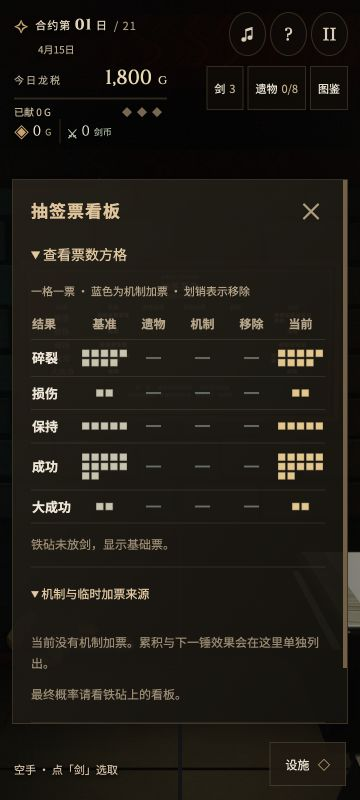

# Dwarf Forge

第一人称 3D 锻造游戏：加热、挥锤、积攒剑币与遗物，完成巨龙的 21 天税收合约。支持桌面浏览器与手机触屏，进度保存在浏览器本地。

**[在线游玩](https://dwarf-forge.gizeta.eu.org/) · [GitHub 源码](https://github.com/AtarisMio/dwarf-forge)**

## 游戏截图

桌面工坊：炉火、铁砧、贡台与遗物购买台。



票数看板：一格一票，遗物加票与机制加票分栏展示，可展开查看机制来源。



手机竖屏：加热剑刃与查看方格票数。点击图片可查看原尺寸。

<table>
  <tr><th>炉火加热</th><th>票数与机制</th></tr>
  <tr>
    <td><a href="docs/screenshots/mobile-heating.jpg"></a></td>
    <td><a href="docs/screenshots/mobile-tickets.jpg"></a></td>
  </tr>
</table>

## 本地运行

需要 Node.js 22.12 或更高版本，以及支持 WebGL 的现代浏览器。

```sh
npm ci
npm run dev
```

打开终端显示的本地地址。检查与生产构建：

```sh
npm test
npm run build
```

构建输出为 `dist/`。GitHub Actions 在 Node.js 22 上执行安装、测试与构建，不自动部署。

## 操作与玩法

- 桌面：WASD／方向键移动，按住左键拖动观察，也可点击空白画面捕获鼠标；Esc 释放鼠标或暂停。
- 对准剑或设施按 E／点击交互。右键放下剑或离开铁砧；铁砧上按 E 取走剑，右键离开会把剑留下。剑架最多存三把。
- 每把剑在炉火加热一次即可保持热态。放上铁砧后，左键／Space 挥锤；十锤蓄满，下一锤释放入神（狂热），期间免碎但不加速。
- 1–5 选择消耗品，Q 使用；拥有回溯物品且上一锤可撤销时，R 回溯。
- 把剑放到贡台凑税，敲铃结算一天；敲铃前可取回。欠税积累怒气，第三阶段致死。合约第 21 天存活即可通关，之后可继续无尽。
- 首日遗物赠礼三选一。之后先将真实剑投入购买台的投剑口兑换剑币，再购买展示格中的遗物；通常一把剑兑换一剑币，与剑的价值无关。刷新花金币，持有遗物最多八件。商人从第三天起每三天来访，库存有限。
- Tab 查看剑；菜单中查看图鉴、遗物和三个存档。新合约的巨龙导览可用 E／右箭头继续、左箭头返回、Esc 跳过。

手机支持横屏和竖屏：左侧摇杆移动，滑动画面观察，轻点目标或“交互”按钮操作。“设施”菜单可前往炉火、铁砧、贡台、购买台及票数看板。详细说明见 [手机体验](docs/mobile-experience.md)。

后墙看板以一格一票显示当前铁砧剑的原始抽签票增减；基准票、遗物加票、机制加票与划销移除票分开展示，设施面板可展开查看每项机制来源。手机详情同样使用方格，铁砧界面显示最终概率。剑的外观由最高达到的等级决定，损伤保留外观，回溯恢复上一锤形态。基础剑从共同形态发展到三个方向和六个家族，另有三种商人剑路线。

## 技术结构

| 模块 | 职责 |
| --- | --- |
| `src/simulation.js`、`src/rules.js` | 交易、锻造、合约、物品和存档验证 |
| `src/main.js`、`src/save-slots.js` | DOM 界面、游戏调度、三个本地存档与共享图鉴 |
| `src/workshop.js`、`src/sword-renderer.js` | Three.js 工坊与程序化剑模型 |
| `src/sword-physics.js`、`src/workshop-motion.js` | 延迟加载的 Rapier 地面物理与交互动画 |
| `src/ticket-board.js`、`src/vector-panels.js` | SVG 生成的清晰场景看板 |
| `src/audio.js`、`src/dragon-voice.js` | 浏览器合成声音与巨龙低吼 |
| `tests/` | Node.js 原生测试，无需浏览器即可运行 |

物理模块无法加载时，地面剑保留静态拾取能力。存储不可用时仍可在当前页面游玩。存档按域名隔离；更换域名不会自动转移旧进度。

## 原作参考与自制资产

本项目是受 [ForgeTax](https://store.steampowered.com/app/5245810/ForgeTax/) 启发的独立网页实现，与原作开发者没有隶属关系。规则参考其 2026 年 10 月官方更新、原作实玩及社区整理；部分数值和复杂组合仍有推定，不能视为完整、官方确认的复刻。来源与置信边界见 [规则证据](docs/rules-evidence.md) 和 [剑的进化](docs/sword-evolution.md)。

工坊、剑模型、幽灵、材质、动画和声音为本项目自制，没有分发原版可执行程序或游戏资产。字体使用浏览器可用字体并提供系统回退。依赖库遵循各自许可证。

## 部署与贡献

使用 Cloudflare Workers 静态资源托管；部署到自己的账户前，请更换 Worker 名称与域名，见 [部署说明](docs/cloudflare-deployment.md)。

欢迎通过 [Issues](https://github.com/AtarisMio/dwarf-forge/issues) 报告问题或提交 Pull Request；参考 [贡献指南](CONTRIBUTING.md)。

## 许可

项目原创代码与自制资产采用 [MIT License](LICENSE)，Copyright © 2026 Dwarf Forge contributors。MIT 授权不涵盖原作品牌、原作资产或第三方依赖的权利。
